# Diagram catalogue

One correct, minimal example per diagram in `SKILL.md`. Copy the closest one, rename everything to
the artifact's own names, and delete what does not apply. Each example passes
`diagram.mjs check` and renders in `diagram.mjs render`; `tests/diagram.test.mjs` keeps it that way.

The running example is a shop: a Customer uses the Web app, which calls the Order API; the Order API
keeps orders in the Orders DB, publishes to the Event bus, and calls the Payment gateway. A Worker
consumes the Event bus. The Admin console is used by Staff. The Identity provider signs users in.
Entities are CUSTOMER, ORDER, ORDER_LINE and PRODUCT. Screens are Cart, Checkout, Payment, Confirmation
and Error. The pipeline runs Build, Unit tests, Scan, Package, Deploy staging, Smoke, Approval and
Deploy production. The Cloud runs Kubernetes in eu-west-1 with Postgres as the managed database; the Web app is served from a CDN.

## 1. Architecture overview — C4 level 1

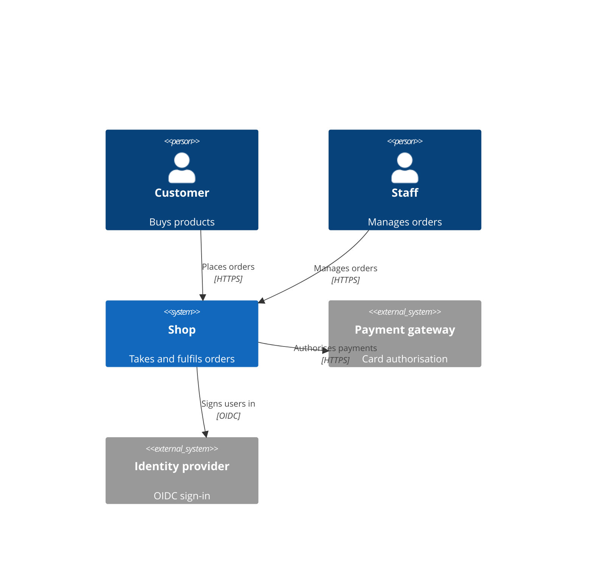

## 2. Component — C4 level 2 (containers)

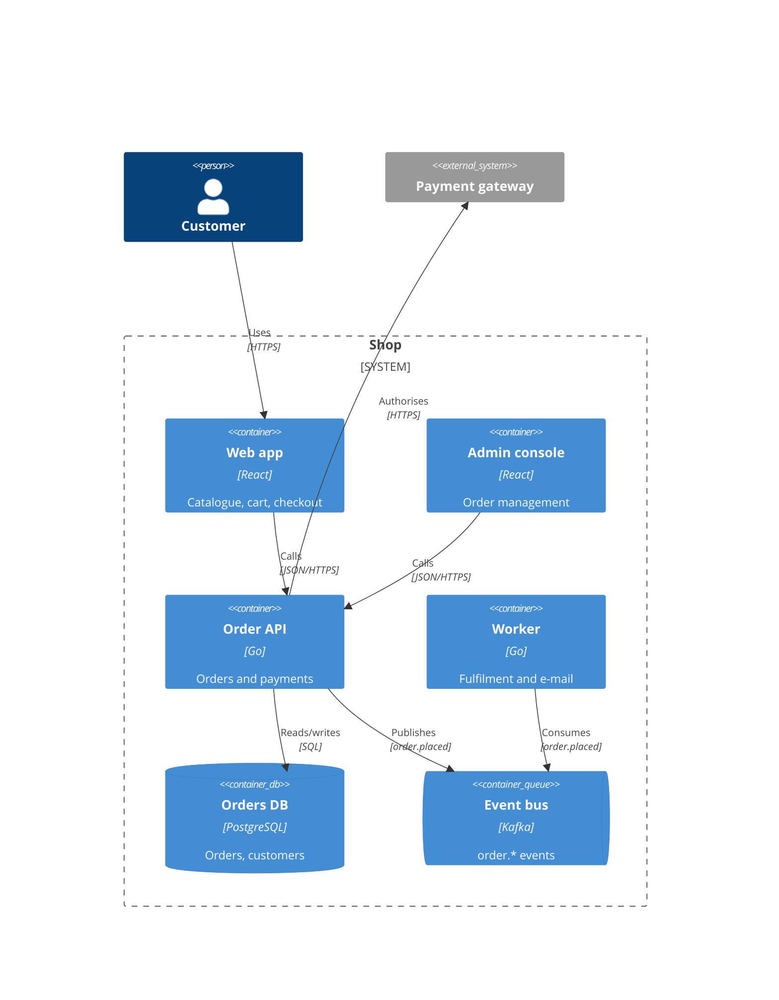

## 3. Sequence — UML, with the failure path

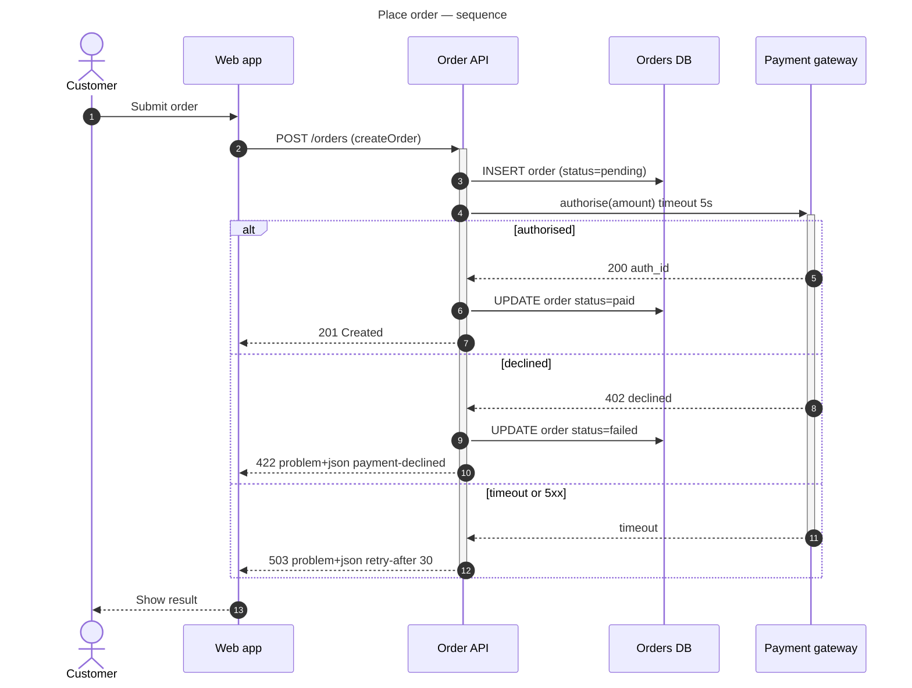

## 4. Activity — UML, with guards and swimlanes

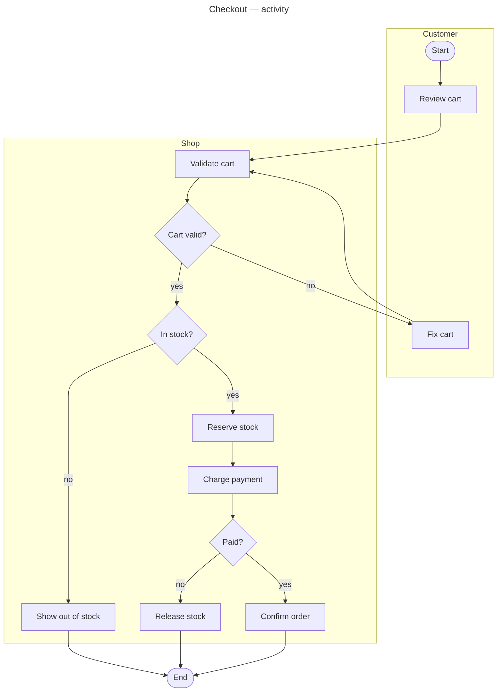

## 5. State machine — UML

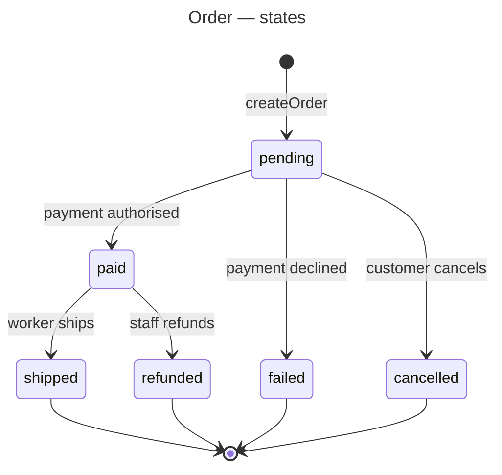

## 6. ER — crow's foot

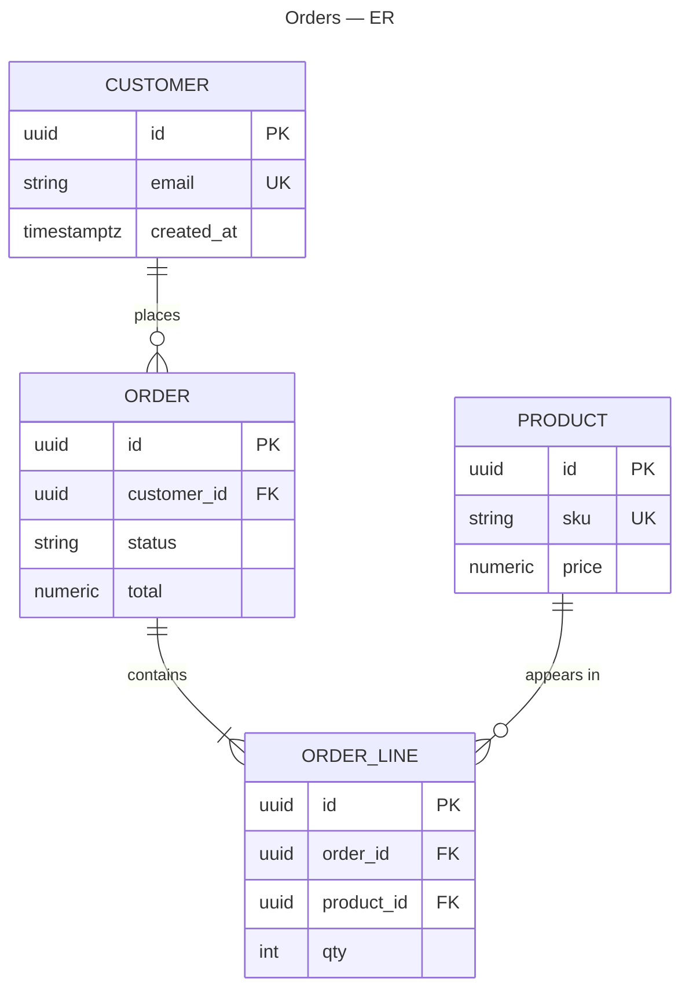

## 7. Data flow (DFD) — level 1, trust boundaries

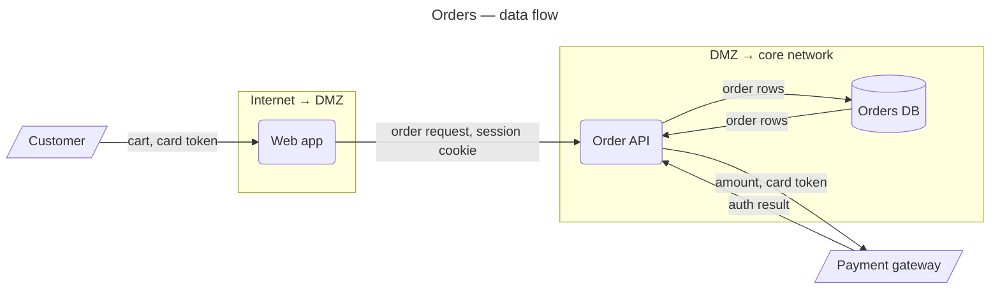

## 9. Screen flow

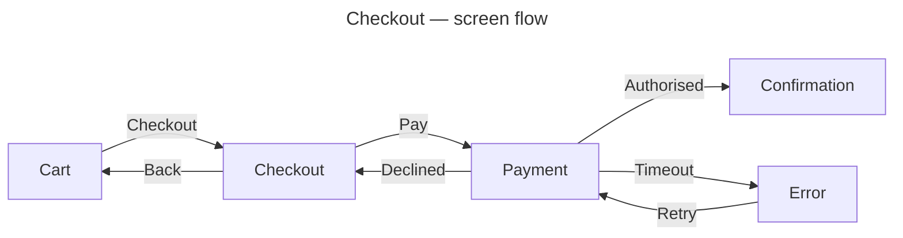

## 10. Deployment

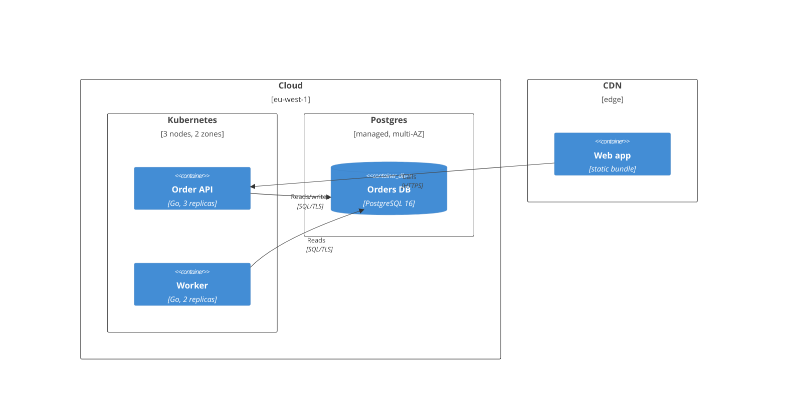

## 11. CI/CD pipeline

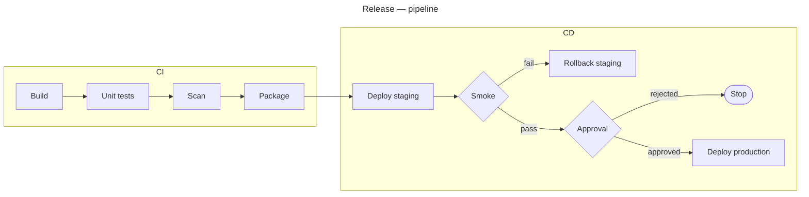

## 12. Migration timeline

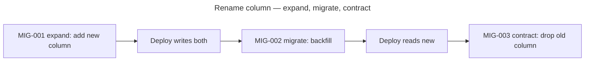
