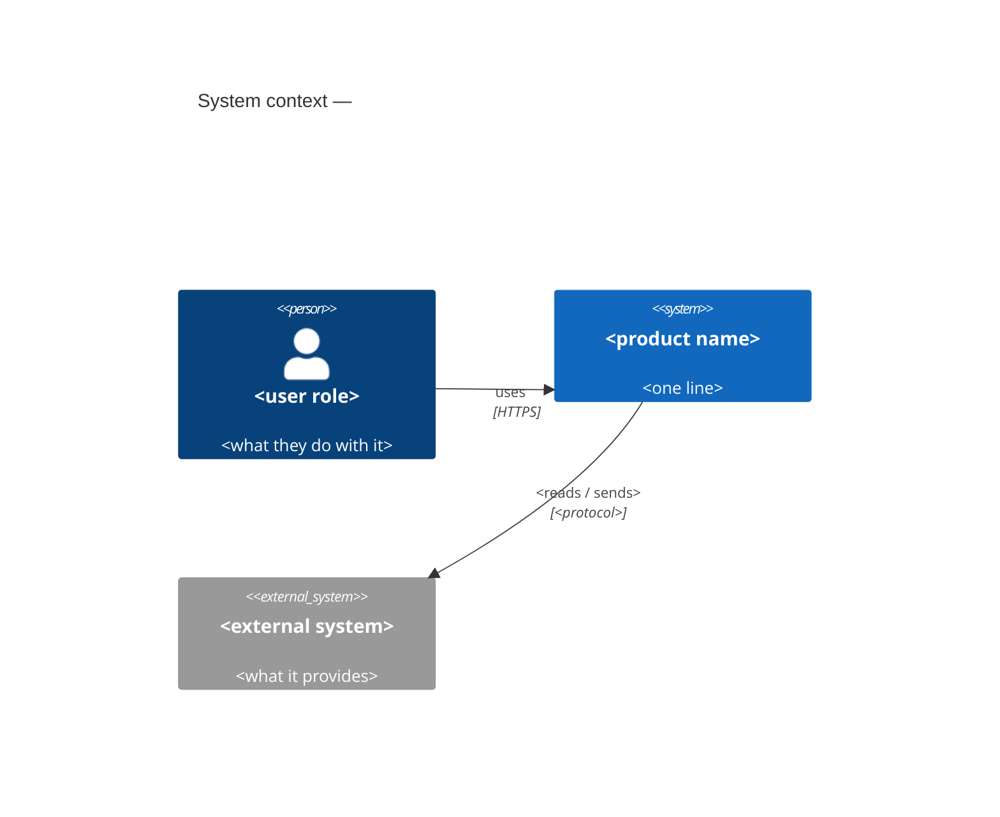
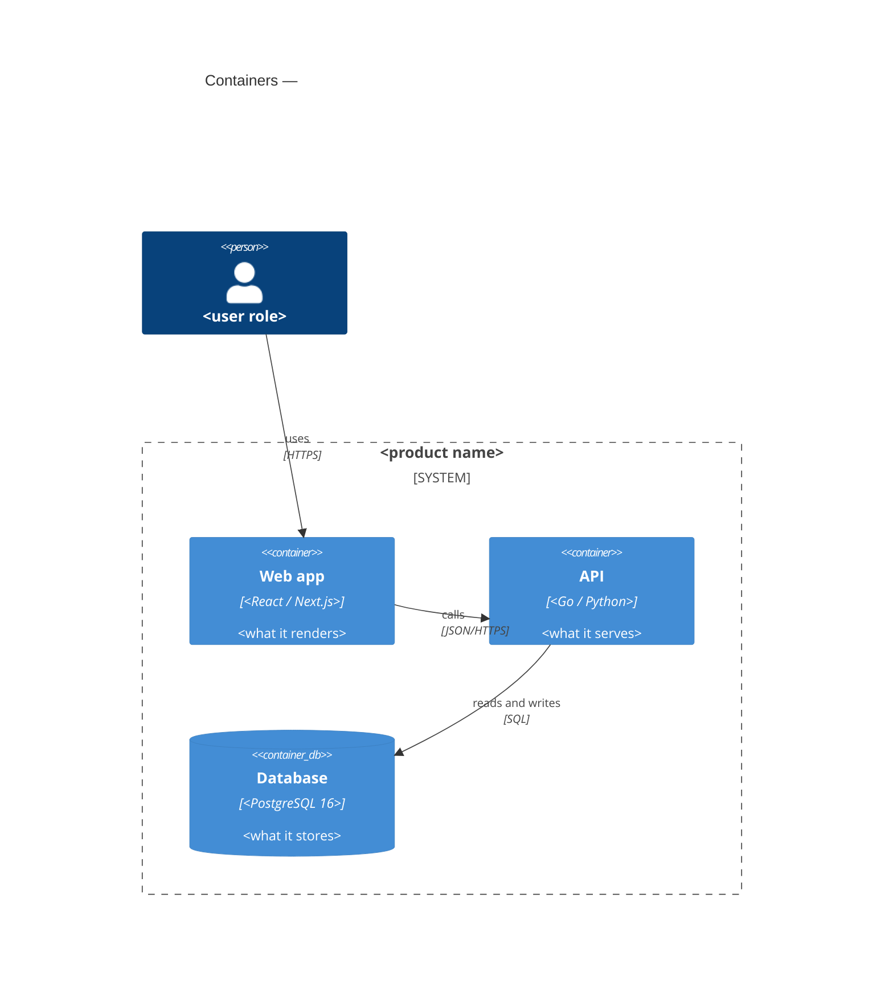

# Architecture

The shape of the system at C4 levels 1 and 2. The reasoning, the alternatives and every decision are
in `.sdlc/design/` and `.sdlc/design/adr/`; this page only draws the boxes and links there.

## System context (C4 level 1)

## Containers (C4 level 2)

## Where to read more

| Question | Document |
|---|---|
| Why this shape | `.sdlc/design/<slug>/architecture.md` |
| A specific decision | `.sdlc/design/adr/` |
| The data | `.sdlc/data/<slug>/data-model.md` |
| The API | `.sdlc/api/<slug>/openapi.yaml` |
